# sl-to-garmin

<p align="center">
  
</p>

Builds a multi-layer OpenStreetMap topo map of Sri Lanka for **Garmin Drive**
GPS devices (Drive 52/66 family), plus `.gpi` POI alert files.

## Screenshots

Taken on an actual Garmin Drive device.

### Map views

| | |
|---|---|
| 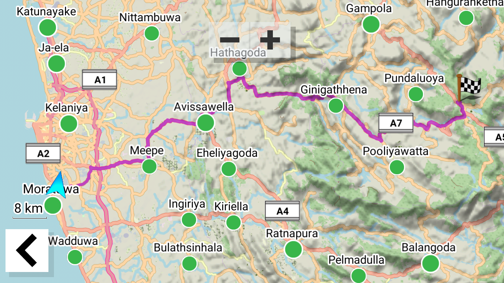 | 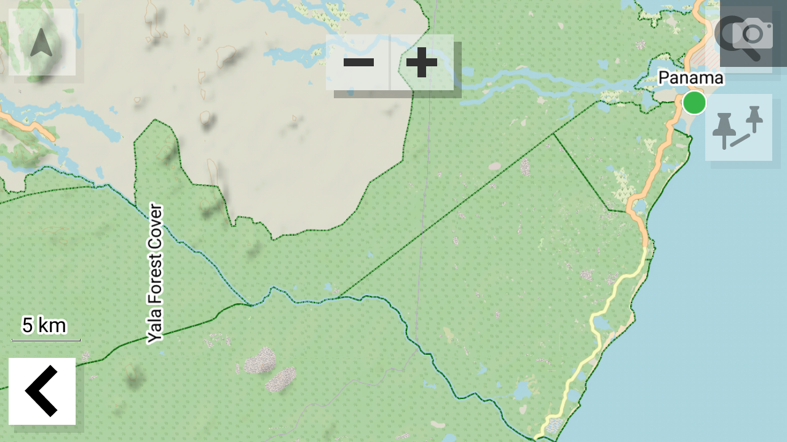 |
| 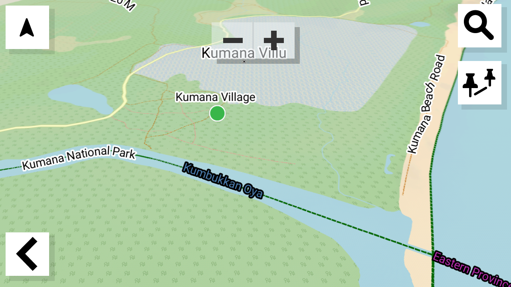 | 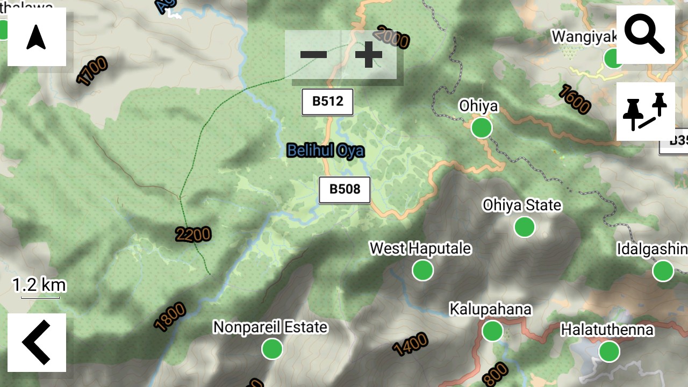 |
| 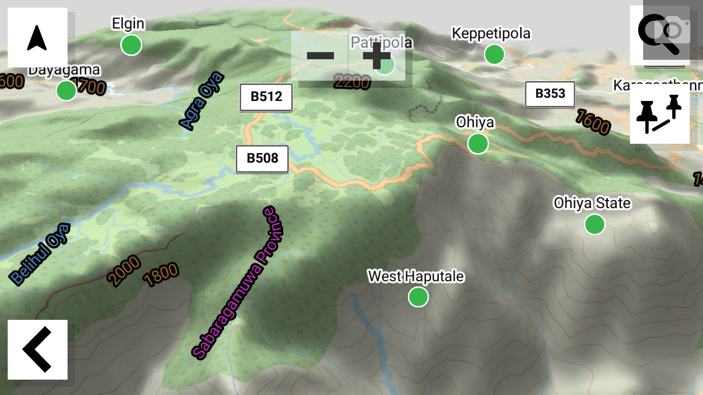 | 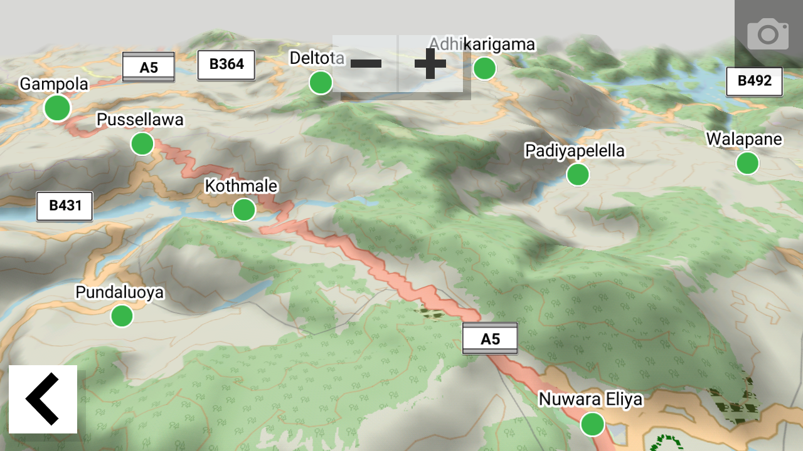 |
| 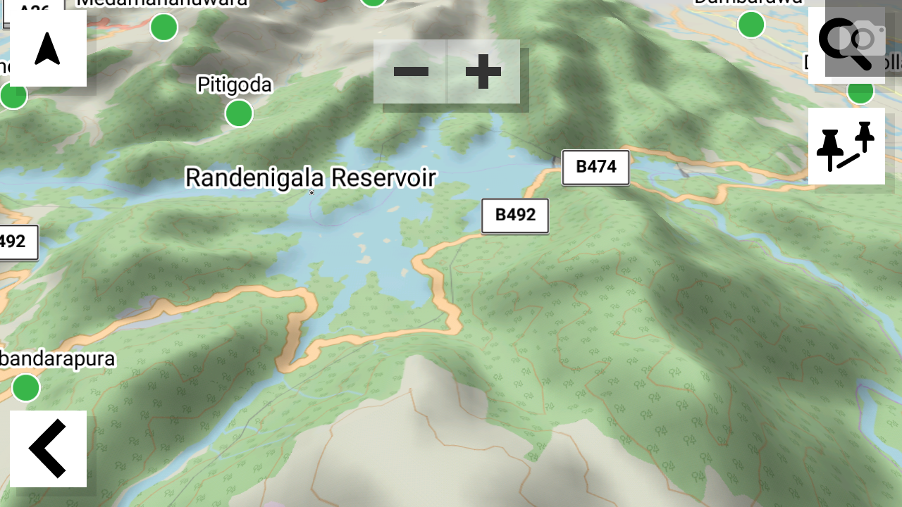 | 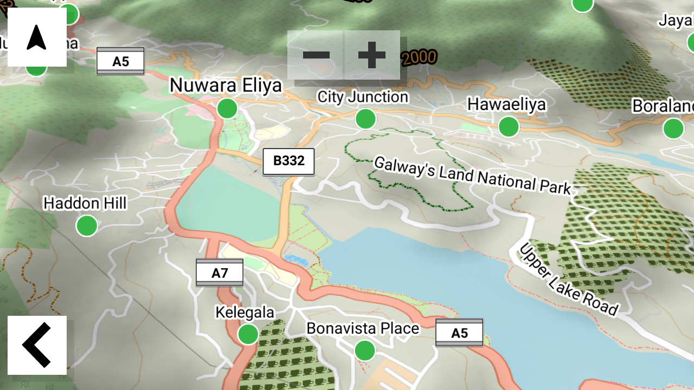 |

### Turn-by-turn navigation

| | |
|---|---|
| 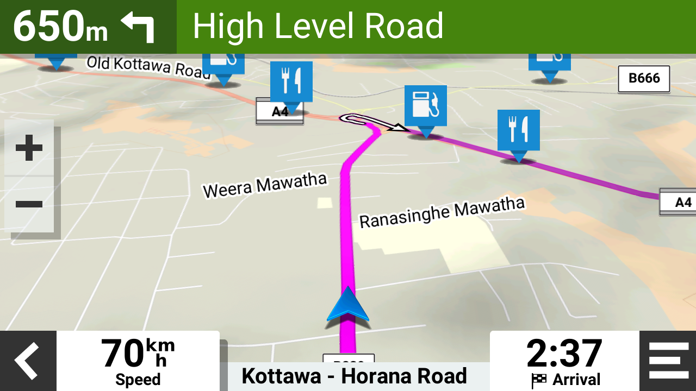 | 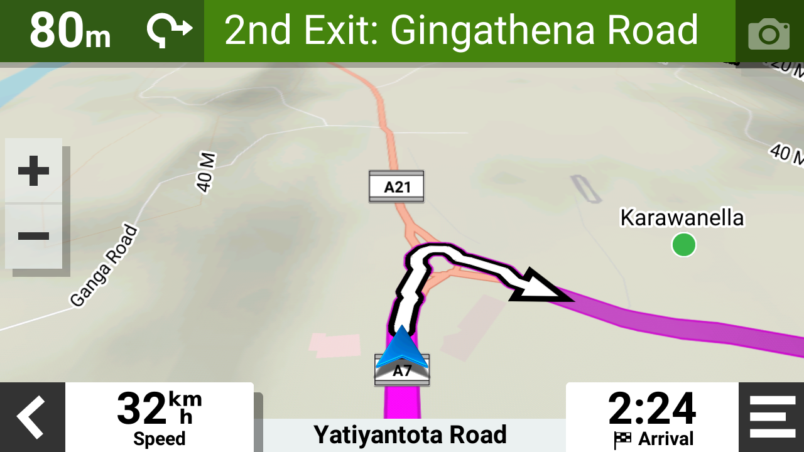 |
| 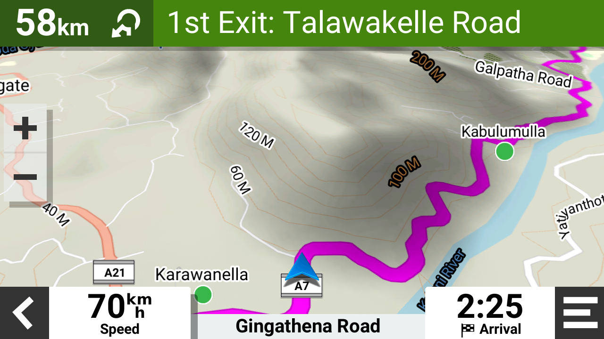 | |

## What it produces

`build_map.sh` builds four layers from the Geofabrik Sri Lanka extract and
merges each into its own device-ready image:

| Layer | Content | Output |
|---|---|---|
| Base | sea/land polygons + DEM hill shading | `sl-base.img` |
| Admin | administrative boundaries | `sl-admin.img` |
| Contours | contour lines (cached) | `sl-contour.img` |
| Roads | roads, POIs, routing + address index | `sl-road.img`, `sl-road_mdr.img`, `sl-road.mdx` |

All outputs land in `build/dist/`. Copy the `.img` files to the `Garmin`
directory of the device (or SD card) to install.

## Prerequisites

Required:

- **Java** (JRE 8+; `JAVA_CMD`/`JAVA_HEAP` in `config/build.conf`)
- **wget** (downloading the OSM extract)
- mkgmap, splitter and osmosis — **vendored** under `tools/`, no install needed

Optional:

- **gpsbabel** — only for `build_gpi.sh`
- **phyghtmap** — only for `hgt2osm.sh` (contour regeneration). If it is not
  on your `PATH`, the script automatically downloads it (pinned to 2.23 from
  the [author's site](http://katze.tfiu.de/projects/phyghtmap/#Download),
  with a small compatibility patch for matplotlib ≥ 3.8 / contourpy ≥ 1.4)
  and installs it into a virtualenv at `.venv/` in the project root
  (gitignored) — this needs `python3`, `python3-venv` and network
  access, and happens once.
- **PostgreSQL + PostGIS** — only for the cleansing stage (`--pg-cleanse`).
  Either a local install, or the provided podman setup (`./db.sh start`,
  needs podman — no database setup required at all).

## Setup

1. **Get the source data**:

   ```sh
   ./download_data.sh
   ```

   This downloads `sri-lanka-latest.osm.pbf` from Geofabrik into `data/cache/`.

   SRTM elevation tiles (`data/hgt/`) are needed for hill shading and are not
   auto-downloaded — the project ships with them, but if you set up from
   scratch, grab SRTM3 tiles covering Sri Lanka (N05–N12, E077–E081), e.g.
   from [viewfinderpanoramas.org](http://viewfinderpanoramas.org/). A
   higher-resolution SRTM1 set lives in `data/hgt-srtm1/`; point `DEM_DIR` at
   it in `config/build.conf` for finer hill shading.

2. **(Only if using `--pg-cleanse`) Set up PostgreSQL** — either:

   **a. Containers via podman (recommended, zero DB setup)**:

   ```sh
   ./db.sh start
   ```

   Runs PostGIS + pgAdmin in a pod (`sl-to-garmin-db`): PostgreSQL 16/PostGIS on
   `localhost:5432` with the `osm_build` superuser role and trust auth (works
   with psql and osmosis as-is), pgAdmin on <http://localhost:8080>
   (`admin@sl-to-garmin.com` / `admin`; the PostgreSQL server is
   pre-registered as `PostgreSQL (sl-to-garmin-db)`).
   Manage with `./db.sh stop|status|rm|purge`. Data persists in the
   `sl-to-garmin-pgdata` volume across stop/start.

   **b. Local PostgreSQL — create the role once**:

   ```sql
   CREATE ROLE osm_build LOGIN CREATEDB SUPERUSER;
   ```

   `SUPERUSER` is needed so the role can create the `postgis`/`hstore`
   extensions inside its own scratch database. Authentication: `psql` uses
   `~/.pgpass` or trust auth; osmosis uses JDBC (which does **not** read
   `~/.pgpass`), so either configure trust auth for `osm_build` on localhost
   in `pg_hba.conf`, or export `PG_PASSWORD` before running the cleanse.

## Usage

### Build the map

```sh
./build_map.sh [--device <type>] [--pg-cleanse] [--pg-experiments]
               [--skip-contours] [--keep-build-dir]
```

| Flag | Effect |
|---|---|
| `--device <type>` | Garmin device family to build for (default: `drive66`); selects the style (`style/<type>/`) and TYP text file (`typ/NN_<type>.txt`) |
| `--pg-cleanse` | Round-trip the extract through PostGIS first (see below) and build from the cleansed PBF |
| `--pg-experiments` | Also run `pg/experiments/*.sql` (implies `--pg-cleanse`) |
| `--skip-contours` | Do not build the contour layer |
| `--keep-build-dir` | Keep the PostGIS scratch database after cleansing (debugging) |

### Other scripts

| Script | Purpose |
|---|---|
| `./download_data.sh [--force]` | Fetch the Geofabrik extract into `data/cache/` |
| `./cleanse_data.sh [--experiments] [--keep-db]` | Run the PostGIS cleansing stage standalone |
| `./db.sh [start\|stop\|status\|rm\|purge]` | Run PostgreSQL/PostGIS + pgAdmin in podman (cleanse-stage database) |
| `./build_gpi.sh [--device <type>]` | Build `.gpi` POI alert files into `build/gpi/` from `config/tags.conf`, using `icons/<device>/` bitmaps |
| `./hgt2osm.sh` | Regenerate contours from SRTM tiles: phyghtmap per tile into `build/contours/` (temporary), then merged with osmosis into `data/cache/sl-contours.osm.pbf` |
| `test/build_test_map.sh` | Build the type-grid test maps — areas and lines (style development) |
| `test/build_map_default.sh` | Full build with mkgmap's built-in default style, no TYP — comparison/testing only; output goes to `build-default/` |

You normally don't need to run `hgt2osm.sh` yourself: if the merged contour
file is missing from `data/cache/`, `build_map.sh` runs it automatically. The
compiled contour layer is cached in `data/cache/sl-contour.img` and rebuilt
whenever the contour source is newer.

## Configuration

All build knobs live in `config/build.conf` and can also be overridden via
environment variables:

| Variable | Default | Meaning |
|---|---|---|
| `FID` / `PID` | `53130` / `1` | Garmin family/product IDs |
| `SERIES_NAME` / `AREA_NAME` | `sl-topo` / `sl` | Map names shown on device |
| `DEVICE` | `drive66` | Garmin device family; derives `STYLE` and the TYP text file (`--device` overrides) |
| `STYLE` | `$DEVICE` | mkgmap style (`style/<style>/`) |
| `TYP_FILE` | *(empty)* | TYP text file to compile; empty = the latest (highest-numbered) `typ/NN_<device>.txt` |
| `DATA_DIR` | `./data` | Source data root — point elsewhere to keep big files off the project disk |
| `BUILD_DIR` | `./build` | Artifact root (wiped each build) |
| `SOURCE_MAP_NAME` | `sri-lanka-latest.osm.pbf` | Raw extract filename (in `data/cache/`) |
| `CLEANSED_MAP_NAME` | `sri-lanka-cleansed.osm.pbf` | Cleansed extract filename |
| `CONTOURS_NAME` | `sl-contours.osm.pbf` | Contour layer input filename (in `data/cache/`) |
| `POLY_FILE` | `data/poly/sri-lanka.poly` | Bounding polygon |
| `GEOFABRIK_URL` | Geofabrik SL extract | Download source |
| `DEM_DIR` | `data/hgt` | DEM tiles for hill shading (`data/hgt-srtm1` for SRTM1) |
| `CONTOUR_STEP` | `50` | Contour interval in meters, passed to phyghtmap `-s` (`hgt2osm.sh`) |
| `JAVA_CMD` / `JAVA_HEAP` | `/usr/bin/java` / `8192M` | JVM settings |
| `PG_DB_NAME` / `PG_HOST` / `PG_PORT` / `PG_USER` | `osm_build` / `localhost` / `5432` / `osm_build` | Cleanse-stage DB connection |

`config/tags.conf` drives `build_gpi.sh` — one category per line:

```
category:key.value,key.value,...[:extra_gpsbabel_options]
```

Example: `police:amenity.police:alerts=1,proximity=3km` builds
`build/gpi/police.gpi` from `amenity=police` nodes, with proximity alerts,
using `icons/drive66/police.bmp` as the icon.

## Directory layout

```
├── build_map.sh / build_gpi.sh / hgt2osm.sh / download_data.sh / cleanse_data.sh / db.sh
├── logo.svg                 # project logo (shown at the top of this file)
├── images/                  # device screenshots (shown above)
├── lib/common.sh          # shared setup + mkgmap/osmosis/splitter wrappers
├── config/                # build.conf (all knobs), tags.conf (POI categories)
├── arg/                   # mkgmap option files, one per layer
├── style/drive66/         # the mkgmap style (Garmin Drive only)
├── typ/                   # monolithic TYP text files per device (NN_<device>.txt);
│                          # the highest-numbered one is compiled into build/<style>.typ
├── icons/drive66/         # POI bitmaps for build_gpi.sh (per device)
├── tools/                 # vendored mkgmap / splitter / osmosis
├── pg/
│   ├── cleanse/           # vetted cleansing rules, run in filename order
│   ├── experiments/       # unvetted SQL — only via --pg-experiments
│   └── analysis/          # tag-statistics exploration queries (scratchpad)
├── test/                  # style-development harness (type grids, default style)
├── data/                  # SOURCE DATA (gitignored: raw extract + contour cache)
│   ├── hgt/               # SRTM3 elevation tiles (+ sl-gdal.vrt)
│   ├── hgt-srtm1/         # higher-resolution SRTM1 tiles (unused by default)
│   ├── poly/              # bounding polygon
│   └── cache/             # raw Geofabrik extract, contour source PBF + compiled contour layer (gitignored)
└── build/                 # BUILD ARTIFACTS (gitignored, wiped each build)
    ├── dist/              # final device-ready images
    └── sri-lanka-cleansed.osm.pbf  # cleanse-stage output (regenerable)
```

## The PostGIS cleansing stage

`./build_map.sh --pg-cleanse` inserts a round-trip through PostgreSQL/PostGIS
between download and map build:

1. Recreate a scratch database (`osm_build`) with `postgis` + `hstore`
2. Create the osmosis pgsnapshot schema
3. Import the raw extract with osmosis `--write-pgsql`
4. Run `pg/cleanse/*.sql` in filename order (each file is one named,
   commented rule; `ON_ERROR_STOP` is on)
5. With `--pg-experiments`: also run `pg/experiments/*.sql`
6. Export the result to `build/sri-lanka-cleansed.osm.pbf`
   (`--read-pgsql --dd --write-pbf`)
7. Drop the scratch DB (unless `--keep-build-dir`)

All four layers then build from the cleansed extract.

**Adding a rule**: put a commented `NN_descriptive_name.sql` in
`pg/cleanse/`. **Trying an idea**: put it in `pg/experiments/` and run with
`--pg-experiments`; once verified (diff/tag-count the cleansed PBF), promote
it to `pg/cleanse/`. `pg/analysis/queries.sql` has tag-statistics queries
useful for deciding rules.

## Outputs and installation

After a build, `build/dist/` contains:

- `sl-base.img`, `sl-admin.img`, `sl-contour.img`, `sl-road.img` — the four
  map layers (each a self-contained gmapsupp image)
- `sl-road_mdr.img`, `sl-road.mdx` — address-search index for the road layer
- `build/gpi/*.gpi` (from `build_gpi.sh`) — POI proximity alerts

Copy all of them to the `Garmin` folder on the device/SD card.

## Testing

- `test/build_test_map.sh` — renders two synthetic grids of Garmin type
  codes using `test/test_style`: `test/area_type_grid.osm` (polygons,
  regenerable with `test/gen_grid_osm.py`) and `test/line_type_grid.osm`
  (lines, regenerable with `test/gen_grid_line_osm.py`); use them to check
  how types render before changing the real style. Both grids draw their
  type codes from `test/area_line_type_codes.csv`.
  `test/drive66_visible_typ.*` lists types visible on the Drive66.
- `test/build_map_default.sh` — full build with the built-in default style
  and no TYP for comparison; writes to `build-default/`, never touches
  `build/`.

## Troubleshooting

- **`source extract missing ... run ./download_data.sh`** — the Geofabrik
  PBF is not in `data/cache/` yet.
- **Contour layer skipped / stale** — the cache `data/cache/sl-contour.img`
  is reused while it is newer than `data/cache/sl-contours.osm.pbf`; to force a
  rebuild, regenerate the contour file with `./hgt2osm.sh` (or delete the
  cache). If the contour file is missing, `build_map.sh` runs `hgt2osm.sh`
  automatically (needs phyghtmap — auto-installed on first run).
- **psql: password authentication failed** — set up `~/.pgpass` or trust
  auth for the `osm_build` role; see Setup.
- **osmosis cleanse import fails with auth errors** — osmosis uses JDBC and
  ignores `~/.pgpass`; use trust auth on localhost or `export PG_PASSWORD`.
- **`permission denied to create extension`** — the `osm_build` role needs
  `SUPERUSER` (or have a superuser pre-create `postgis`/`hstore` in the
  scratch DB).
- **`./db.sh start` fails with a port-binding error** — something (usually a
  local PostgreSQL) is already listening on 5432. Stop it, or run with a
  different port: `PG_PORT=5433 ./db.sh start` (the cleanse scripts read
  `PG_PORT` from `config/build.conf`, so set it there too).
- **`could not resize shared memory segment ... No space left on device`
  during cleanse** — PostgreSQL's dynamic shared memory (`/dev/shm`), not the
  data volume. Containers default to 64 MiB; `db.sh` sizes the pod's
  `/dev/shm` via `PG_SHM_SIZE` (default 2g). Raise it if the import still
  fails. Note: the size is fixed at pod creation — recreate with
  `./db.sh rm && PG_SHM_SIZE=4g ./db.sh start` (the data volume survives).
- **mkgmap runs out of memory** — raise `JAVA_HEAP` in `config/build.conf`.

## Attribution

This project stands on the shoulders of these open source tools and data
providers — many thanks to their authors and contributors.

### Tools and libraries

- [mkgmap](https://www.mkgmap.org.uk/) — converts OSM data into Garmin
  `.img` map images (vendored: r4924, `tools/mkgmap-r4924/`)
- [splitter](https://www.mkgmap.org.uk/) — splits large OSM extracts into
  tiles for mkgmap (vendored: r654, `tools/splitter-r654/`)
- [Osmosis](https://wiki.openstreetmap.org/wiki/Osmosis) — OSM data
  filtering, merging and PostGIS import/export (vendored: 0.49.2,
  `tools/osmosis-0.49.2/`)
- [phyghtmap](http://katze.tfiu.de/projects/phyghtmap/) — generates contour
  lines from SRTM elevation tiles (optional, `hgt2osm.sh`)
- [GPSBabel](https://www.gpsbabel.org/) — builds `.gpi` POI alert files
  (optional, `build_gpi.sh`)
- [PostgreSQL](https://www.postgresql.org/) +
  [PostGIS](https://postgis.net/) — power the optional data-cleansing stage
- [pgAdmin](https://www.pgadmin.org/) — database admin UI in the podman
  setup (`db.sh`)

### Data providers

- [OpenStreetMap](https://www.openstreetmap.org/) contributors — all map
  data, licensed under the
  [Open Data Commons Open Database License (ODbL)](https://opendatacommons.org/licenses/odbl/).
  Maps built with this project must carry the attribution
  "© OpenStreetMap contributors".
- [Geofabrik](https://www.geofabrik.de/) — provides the ready-made Sri
  Lanka OSM extract that the build downloads.
- [NASA Shuttle Radar Topography Mission (SRTM)](https://www2.jpl.nasa.gov/srtm/)
  — elevation data used for hill shading and contour lines.
- [viewfinderpanoramas.org](http://viewfinderpanoramas.org/) (Jonathan de
  Ferranti) — void-filled SRTM tiles (`data/hgt/`, `data/hgt-srtm1/`).
